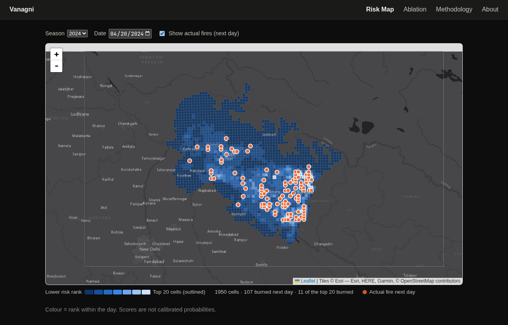
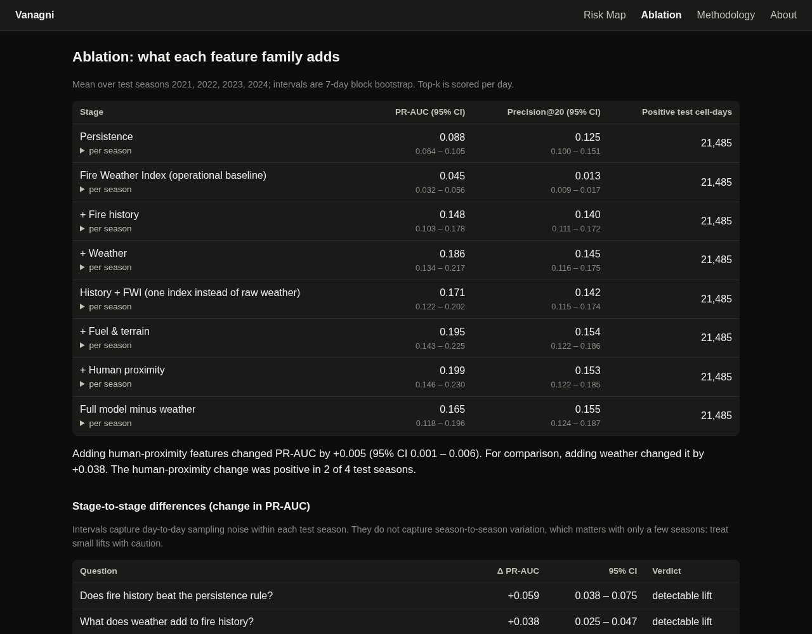

# Vanagni

**Next-day forest-fire risk for Uttarakhand, India: a backtested, leakage-tested research project.**

For every 5 km grid cell, the model predicts whether a satellite will detect a vegetation fire
there *tomorrow*, from the cell's fire history, weather, fuel and terrain, and its proximity to
people (roads, settlements, cropland). Every prediction is scored against what actually burned.

> **The question it tests.** In a fire regime that is reportedly 90–95% human-caused, do human-proximity
> features add more predictive lift than weather?
>
> **The answer, on four held-out fire seasons (2021–2024): no.** Weather added **+0.038** PR-AUC;
> human-proximity features added **+0.005**, positive in only 2 of the 4 seasons and
> indistinguishable from zero on places the model never trained on.
> The full write-up is in [REPORT.md](REPORT.md).



*Risk map for 2024-04-20. Cells are coloured by risk rank within the day, the 20 highest-ranked
cells are outlined, and orange dots are the fires detected the next day (11 of the top 20 burned).*



## What was built

| | |
|---|---|
| **Leakage-safe panel** | One row per cell and day (5.3 M rows across the 1,950 scored cells); the label is a qualifying fire on day *d+1*, and every feature is computed from day *d* or earlier. Windows are array-based, never positional, so a missing day cannot shift one. |
| **Honest label** | Raw satellite detections are filtered to vegetation fires: FIRMS static-source flag, confidence, ≥ 50 % natural vegetation in the 375 m footprint, no repeat hotspots (kilns, factories). 342,805 raw detections become 91,268 qualifying ones. |
| **Staged ablation** | Persistence → fire history → + weather → + fuel & terrain → + human proximity, plus a "full model minus weather" run so credit does not depend on the order features are added. |
| **Operational baseline** | The Canadian Fire Weather Index, implemented from the published equations and checked against the published reference case, as a fixed-formula rule and as a model feature. |
| **Rigour** | Rolling-origin evaluation over four seasons, 7-day block-bootstrap confidence intervals on every metric and every stage difference, a spatial-block holdout (whole 50 km blocks held out), label-threshold sensitivity runs, and automated leakage tests that gate the Methodology page. |
| **Demo** | A read-only Flask API and four plain-JS screens (About, Risk Map, Ablation, Methodology) over pre-computed results. Nothing trains or scores on request. |
| **A second region** | `config/odisha.yaml` plus a shared `config/defaults.yaml`: Odisha's grid, terrain, land cover, roads and 30 districts are built by the same pipeline. See [Scaling](#scaling). |

## Results at a glance

Mean over test seasons 2021–2024 (21,485 positive test cell-days; base rate 0.9–3.3 % per season):

| Stage | PR-AUC (95 % CI) |
|---|---|
| Persistence (fire today → fire tomorrow) | 0.088 (0.064–0.105) |
| Fire Weather Index, as a rule | 0.045 (0.032–0.056) |
| + fire history | 0.148 (0.103–0.178) |
| + weather | 0.186 (0.134–0.217) |
| + fuel & terrain | 0.195 (0.143–0.225) |
| + human proximity | 0.199 (0.146–0.230) |
| full model minus weather | 0.165 (0.118–0.196) |

Intervals reflect day-to-day noise within seasons, not season-to-season variation; with four seasons,
treat small differences with caution. Precision@20 is 0.14–0.155 for every learned stage (persistence
0.125), and the stage-to-stage differences in it are within its intervals.
[REPORT.md](REPORT.md) has the full tables, the spatial holdout, the sensitivity runs and the limitations.

## Quick start

```bash
conda env create -f environment.yml      # conda-forge: rasterio/geopandas bind to GDAL
conda activate vanagni                   # must be active: the DEM download shells out to GDAL tools
pip install -e .
make lint test                           # ruff + the test suite, leakage tests included
```

The data is not in the repo (it is large and reproducible). To rebuild everything for Uttarakhand:

```bash
cp .env.example .env                     # add FIRMS_MAP_KEY (free, firms.modaps.eosdis.nasa.gov/api)
# ~/.cdsapirc with a free Copernicus CDS key (cds.climate.copernicus.eu)
make pipeline                            # ingest → static → weather → fwi → panel → train → evaluate
make serve                               # http://localhost:5000
```

Every step is idempotent and resumable (`make -n pipeline` lists them in order). The slow step is
`weather`: ERA5-Land requests wait hours in Copernicus's queue and are capped per account, so a full
window takes days. Everything else is minutes to about an hour. `make weather-resample` uses whatever
months are already on disk.

## Repository layout

```
config/            defaults.yaml (shared) + one file per region + fire-calendar CSVs
src/wfpin/
  ingest/          fire.py (FIRMS), weather.py (ERA5-Land, resumable, queue-aware)
  static_layers.py grid, terrain, land cover, OSM roads/settlements/districts, calendar join
  fwi.py           Canadian Fire Weather Index
  panel.py         the dense, leakage-safe cell × day panel and the label filter
  features.py      feature families and the stage → features registry
  train.py         per-stage, per-season models; spatial-block holdout
  evaluate.py      metrics, bootstrap CIs, methodology and map artifacts
  serve/           read-only Flask API + static frontend
tests/             leakage, static-invariance, FWI reference values, config, API, ...
Makefile           the pipeline, one target per step
```

## Design principles

* **Config-driven.** Region, window, grid, label rules, stages and model settings live in YAML.
  A region file states only what is regional (bbox, CRS, data paths, season calendar, OSM source);
  those keys exist in no default, so a region cannot silently inherit another's.
* **Leakage is tested, not asserted.** `tests/test_panel_leakage.py` truncates the future and checks no
  earlier feature changes, on synthetic data and on the real inputs. It gates the Methodology page.
* **Say what the numbers are.** Model scores are not calibrated probabilities, so the map shows rank;
  intervals say what they do and do not cover; limitations are listed on the page that shows the result.

## Scaling

A second state is a config file, not new code. `config/odisha.yaml` (37 lines) builds Odisha's
6,608-cell grid, terrain, land cover, roads and districts with the same code, in its own
`data/odisha/` directory and an equal-area projection. Getting there required making paths and the
projection config-driven, computing the SRTM tile cap from the bbox, and handling land-cover tiles
that do not exist over open water.

What is **not** done, and is the honest next step: Odisha's weather and modelling (a multi-day
Copernicus wait), and its fire season, which runs November to June and so wraps the new year, something
the panel's season test cannot yet represent. Beyond that: district-level human-ignition calendars,
calibrated probabilities, and live scoring from a weather forecast instead of reanalysis.

## Limitations

Backtest only; one state; four seasons; ERA5-Land (about 9–11 km) is coarser than the 5 km grid;
the fire calendar is one state-wide window, so the *timing* half of the human-ignition hypothesis is
untested; OSM roads are today's, applied to 2017–2024; land cover cannot separate chir pine from other
forest. See [REPORT.md](REPORT.md) for the complete list.

## Licence

MIT, see [LICENSE](LICENSE).
